# Diagramas UML - Gestor de Citas Médicas

## 1. S1: Inicio del Sistema, Autenticación de Personal y Carga de Agenda Semanal

### 1.1 Diagrama de Estados (DE-S1-Inicio_Autenticacion_CargaAgenda)
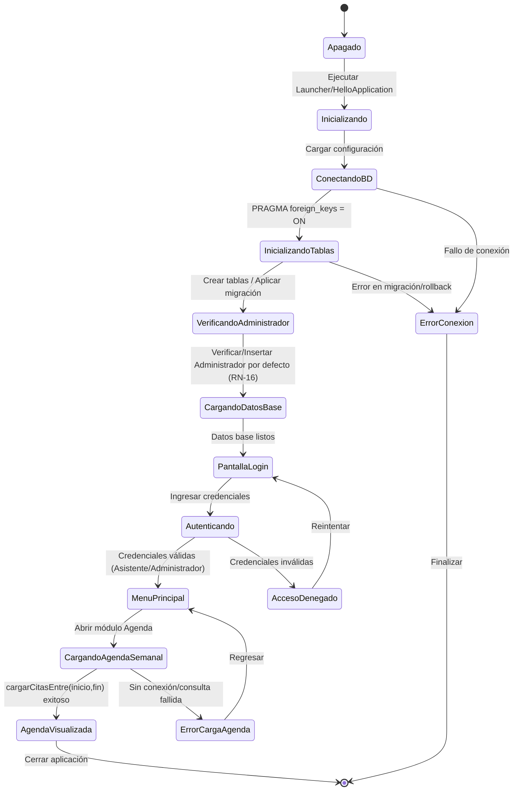

### 1.2 Diagrama de Casos de Uso (DCU-S1-Inicio_Autenticacion_CargaAgenda)
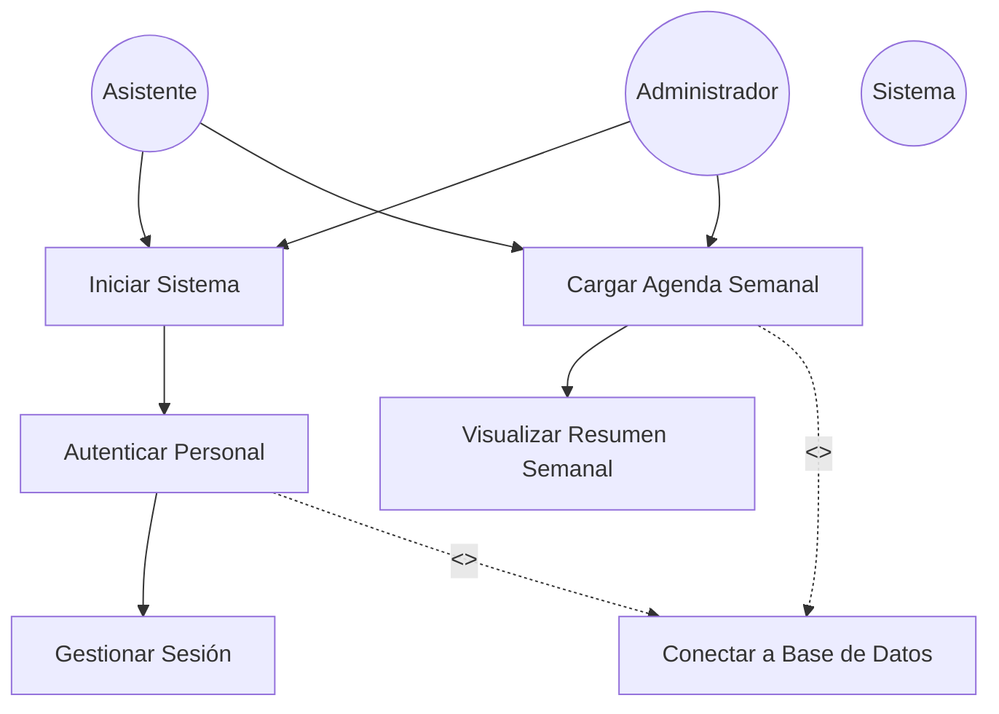

### 1.3 Diagrama de Secuencias (DS-S1-Inicio_Autenticacion_CargaAgenda)
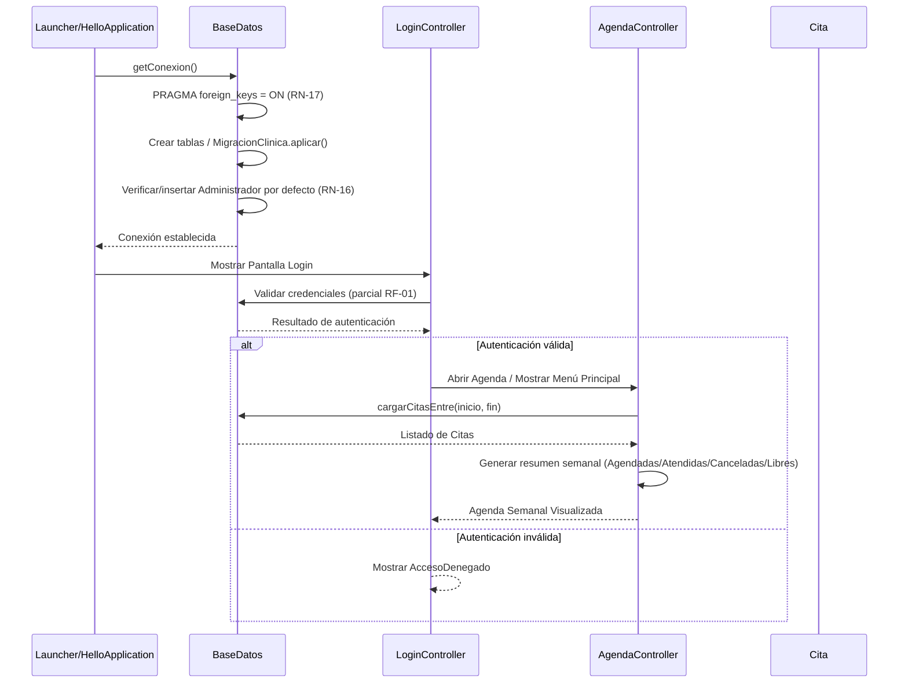

### 1.4 Diagrama de Colaboraciones (DCO-S1-Inicio_Autenticacion_CargaAgenda)
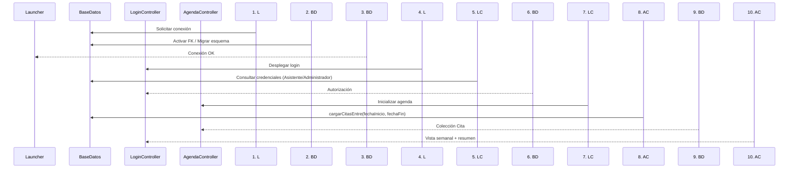

## 2. S2: Agendamiento, Validación de Horario y Registro de Cita Médica

### 2.1 Diagrama de Estados (DE-S2-Agendamiento_Validacion_RegistroCita)
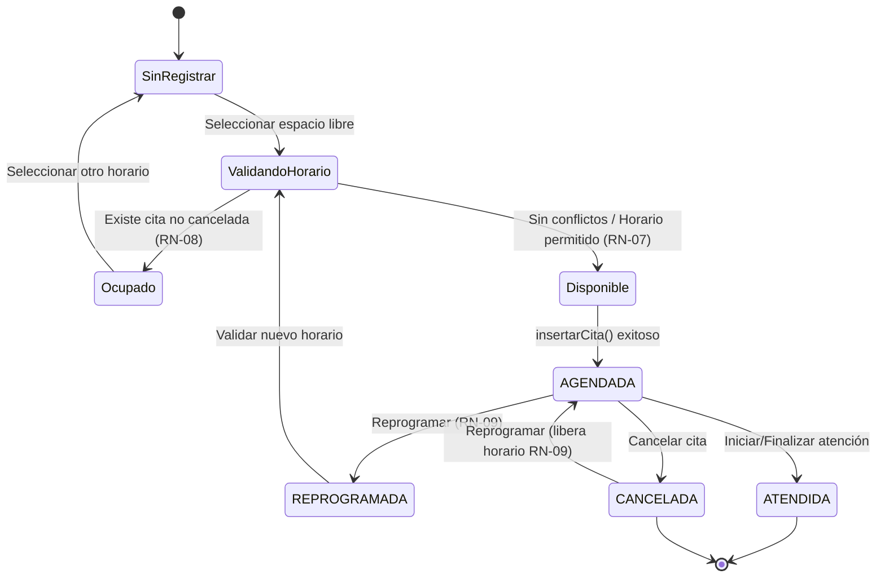

### 2.2 Diagrama de Casos de Uso (DCU-S2-Agendamiento_Validacion_RegistroCita)
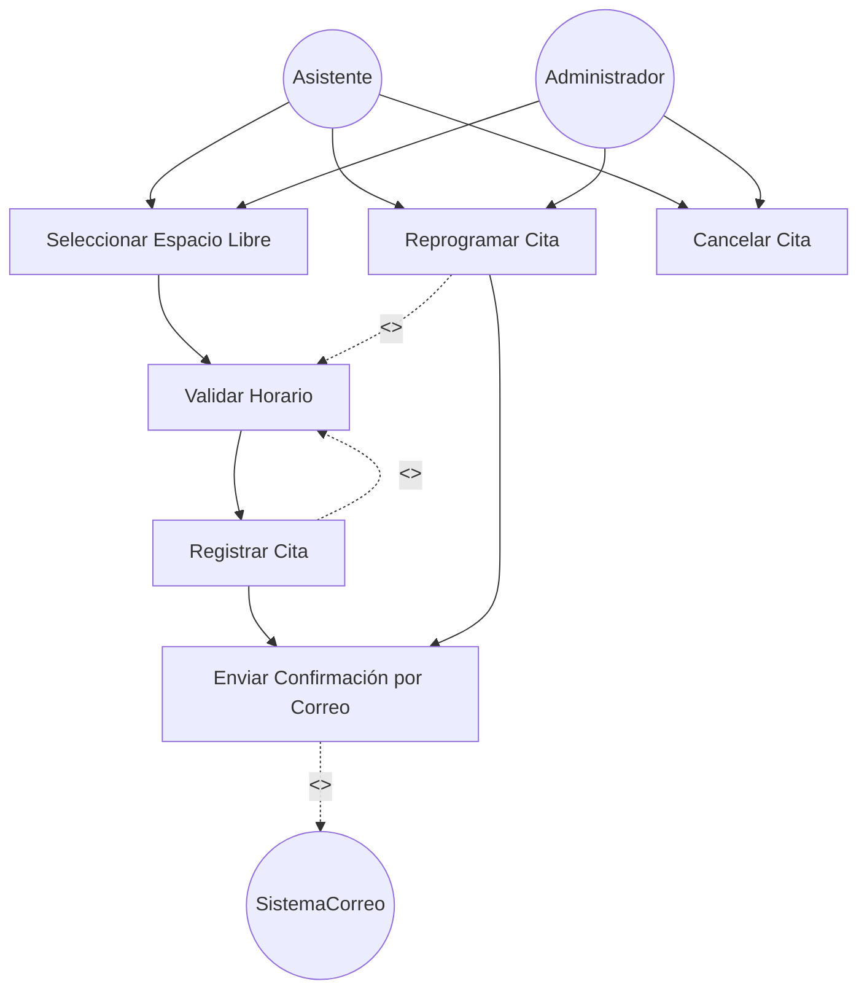

### 2.3 Diagrama de Secuencias (DS-S2-Agendamiento_Validacion_RegistroCita)
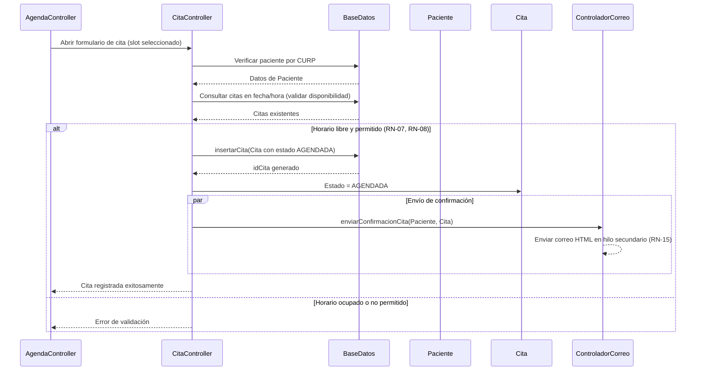

### 2.4 Diagrama de Colaboraciones (DCO-S2-Agendamiento_Validacion_RegistroCita)
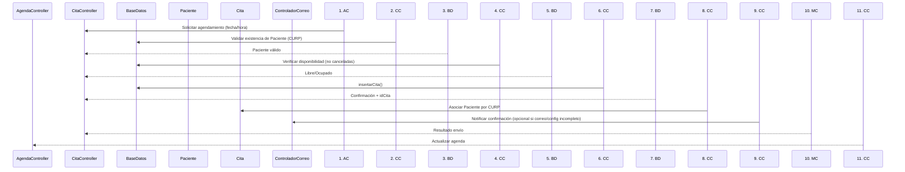

## 3. S3: Atención de Consulta Médica en Tiempo Real y Generación de Receta en PDF

### 3.1 Diagrama de Estados (DE-S3-Atencion_Consulta_RecetaPDF)
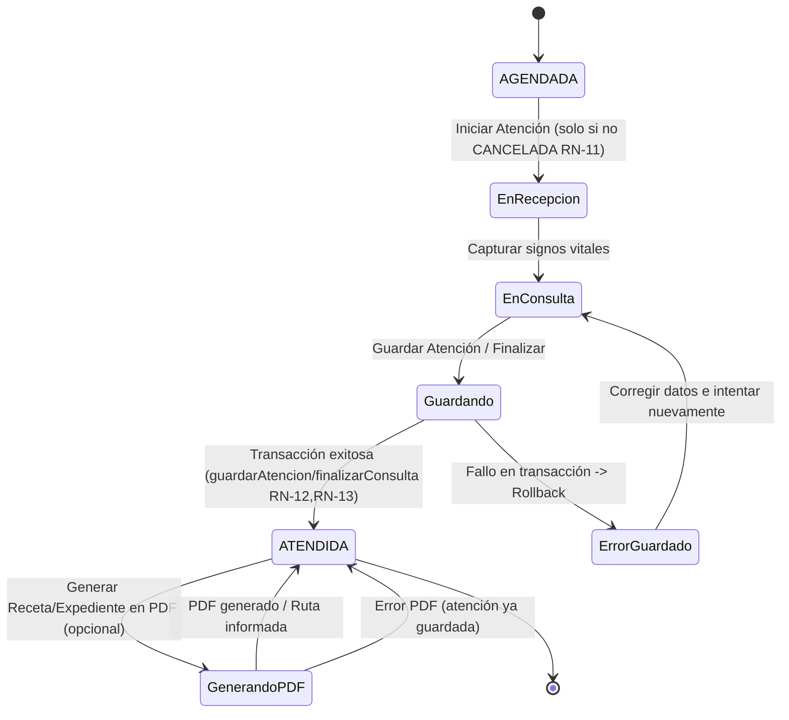

### 3.2 Diagrama de Casos de Uso (DCU-S3-Atencion_Consulta_RecetaPDF)
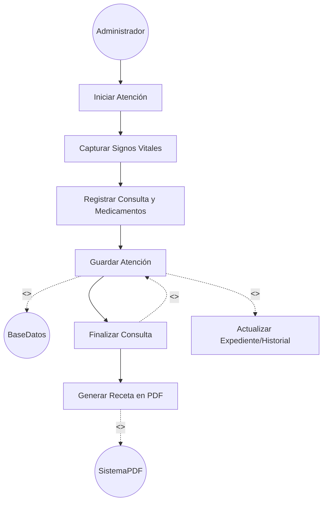

### 3.3 Diagrama de Secuencias (DS-S3-Atencion_Consulta_RecetaPDF)
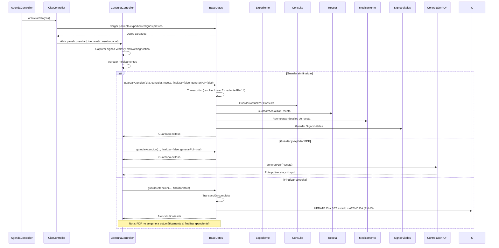

### 3.4 Diagrama de Colaboraciones (DCO-S3-Atencion_Consulta_RecetaPDF)
```mermaid
sequenceDiagram
    participant CC as CitaController
    participant COC as ConsultaController
    participant BD as BaseDatos
    participant EXP as Expediente
    participant CON as Consulta
    participant REC as Receta
    participant MED as Medicamento
    participant SV as SignosVitales
    participant PDF as ControladorPDF
    participant ADM as Administrador

    1. CC->>COC: Iniciar atención (validar no CANCELADA)
    2. COC->>BD: Cargar datos clínicos previos
    3. BD-->>COC: Paciente/Expediente/Signos
    4. COC->>BD: guardarAtencion() coordinación transaccional
    5. BD->>EXP: Resolver/Crear Expediente
    6. BD->>CON: Persistir nota clínica
    7. BD->>REC: Persistir Receta (vinculada a Cita/Administrador)
    8. BD->>MED: Persistir Detalle_receta (reemplazo transaccional)
    9. BD->>SV: Persistir SignosVitales
    10. BD->>BD: Commit / Rollback si falla
    11. alt Finalizar
        12. BD->>BD: Marcar Cita ATENDIDA
    end
    13. alt Generar PDF
        14. COC->>PDF: generarPDF(Receta)
        15. PDF->>ADM: Obtener datos fijos prescriptor/establecimiento
        16. PDF->>REC: Obtener datos para impresión
        17. PDF-->>COC: Archivo PDF generado
    end
```

## Trazabilidad

| Elemento del código | Diagramas donde aparece |
| :-- | :-- |
| `BaseDatos` | S1, S2, S3 |
| `Launcher/HelloApplication` | S1 |
| `LoginController` | S1 |
| `AgendaController` | S1, S2, S3 |
| `CitaController` | S2, S3 |
| `ConsultaController` | S3 |
| `ControladorCorreo` | S2 |
| `ControladorPDF` | S3 |
| `Paciente` | S1, S2 |
| `Cita` / `Estado` | S1, S2, S3 |
| `Expediente` | S1, S3 |
| `Consulta` | S3 |
| `Receta` | S3 |
| `Medicamento` | S3 |
| `SignosVitales` | S3 |
| `Administrador` / `Asistente` | S1, S2, S3 |

## Notas

- La autenticación mostrada en S1 es **parcial** (RF-01). Hoy no hay validación contra base de datos.
- En S2, el envío por correo es **condicional**: si el paciente no tiene correo o la configuración SMTP está incompleta, la cita se guarda igualmente (RN-15).
- En S3, `guardarAtencion` actúa como operación coordinadora transaccional. Al finalizar se marca la cita como `ATENDIDA` (RN-12, RN-13), pero **la generación de PDF no es automática** (pendiente de implementación).
- Se consideran los pendientes documentados: transferencia del motivo de recepción, prioridad de signos al reabrir, validación numérica de recepción y regeneración/custodia de PDF.
