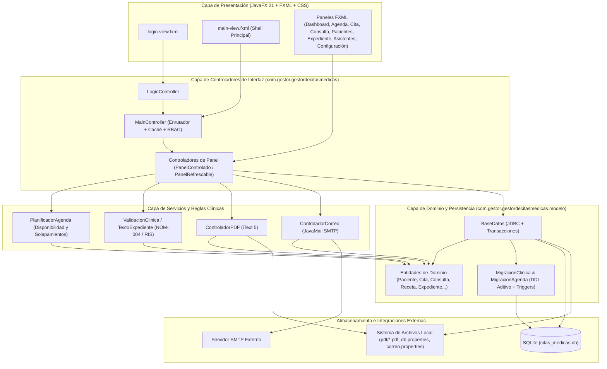
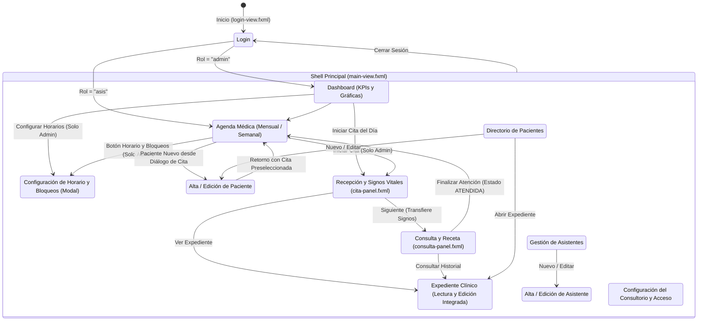
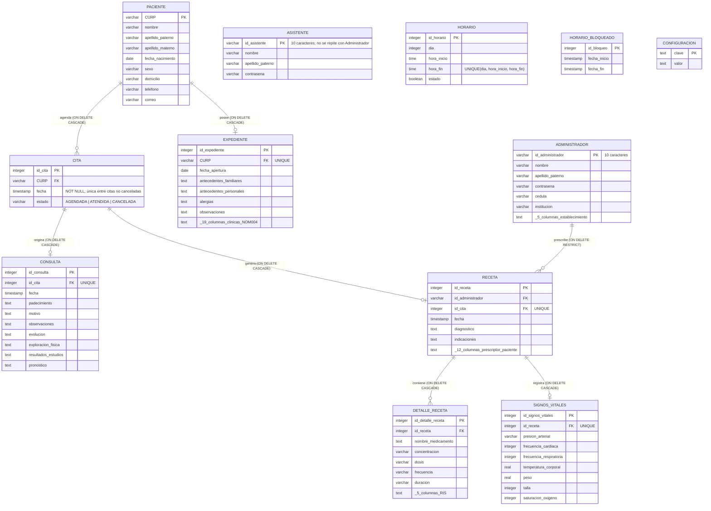
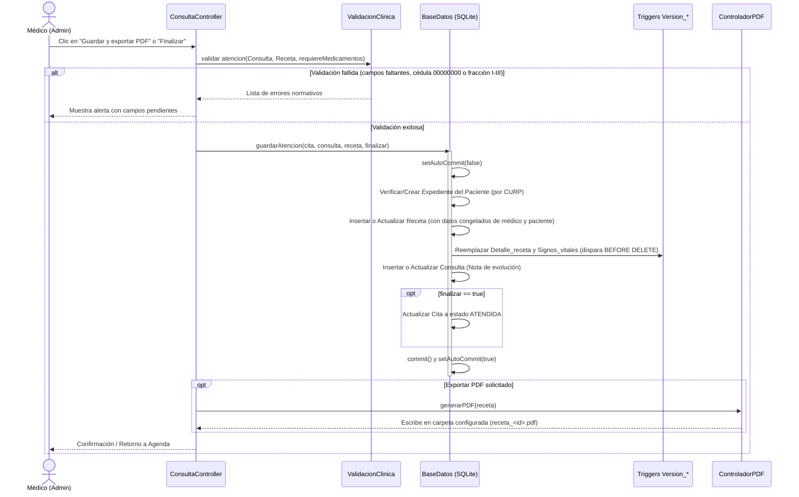

# Arquitectura General del Sistema — Gestor de Citas Médicas

Documento de referencia arquitectónica para el **Gestor de Citas Médicas**, una aplicación de escritorio monolítica desarrollada con **JavaFX 21** y **SQLite**, orientada a la gestión de consultorios médicos de consulta externa (agenda, recepción, consulta clínica, expediente electrónico y emisión de recetas ordinarias bajo estándares normativos mexicanos NOM-004-SSA3-2012 y RIS).

---

## 1. Visión General y Estilo Arquitectónico

El sistema sigue una **arquitectura monolítica de escritorio en capas (Layered Desktop Architecture)** basada en el patrón **MVC (Modelo–Vista–Controlador)** adaptado a JavaFX:

- **Capa de Presentación (Vista):** Archivos declarativos FXML (`src/main/resources/.../*.fxml`), hojas de estilo CSS (`cita.css`) e iconografía vectorial personalizada mediante **Ikonli** (`FlaticonIcons`).
- **Capa de Control de Interfaz y Navegación (Controladores FX):** Clases `*Controller` en el paquete `com.gestor.gestordecitasmedicas.controlador` que gestionan eventos de usuario, estado visual, caché de paneles y transiciones.
- **Capa de Servicios y Reglas de Negocio (`servicio` y utilidades de `modelo`):** Servicios especializados para validación clínica (`ValidacionClinica`), formateo de textos normativos (`TextoExpediente`), planificación de horarios (`PlanificadorAgenda`), generación de documentos (`ControladorPDF`) y notificaciones (`ControladorCorreo`).
- **Capa de Dominio y Persistencia (`modelo`):** Entidades del dominio clínico (`Paciente`, `Cita`, `Expediente`, `Consulta`, `Receta`, `Medicamento`, `SignosVitales`, `Horario`, `HorarioBloqueado`, `Administrador`, `Asistente`) junto con el gestor centralizado de acceso a datos (`BaseDatos`) y los motores de migración automática (`MigracionClinica`, `MigracionAgenda`).



---

## 2. Stack Tecnológico y Dependencias

| Componente | Tecnología / Librería | Versión | Propósito en el Sistema |
|---|---|---|---|
| **Lenguaje y Runtime** | Java (JDK 17+ en ejecución) | Target bytecode 8 / Runtime 17+ | Lenguaje base de la aplicación. |
| **Framework UI** | JavaFX (`controls`, `fxml`, `web`, `swing`) | `21.0.6` | Renderizado gráfico, vistas declarativas FXML, gráficas (`BarChart`, `PieChart`) y diálogos. |
| **Componentes UI Extra** | ControlsFX / FormsFX / TilesFX | `11.2.1` / `11.6.0` / `21.0.9` | Controles extendidos para formularios y paneles visuales. |
| **Iconografía** | Ikonli (`ikonli-javafx`) + Fuente TTF Uicons | `12.3.1` | Proveedor SPI propio (`FlaticonIconsIkonHandler`) con fuente `uicons-regular-rounded.ttf`. |
| **Base de Datos** | SQLite (`sqlite-jdbc`) | `3.50.3.0` | Motor relacional embebido en archivo local (`citas_medicas.db`) con soporte de triggers y transacciones ACID. |
| **Generación de PDF** | iText PDF (`itextpdf`) | `5.4.1` | Creación programática de recetas médicas ordinarias y expedientes clínicos en formato A4. |
| **Correo Electrónico** | JavaMail (`javax.mail`) | `1.6.2` | Envío asíncrono de confirmaciones de citas en formato HTML vía SMTP/TLS/SSL. |
| **Pruebas Automatizadas** | JUnit Jupiter (JUnit 5) | `5.12.1` | Pruebas unitarias y de integración sobre bases SQLite temporales aisladas. |
| **Construcción** | Apache Maven (`mvnw`) | `3.13.0` (compiler) | Gestión de dependencias, empaquetado (`javafx-maven-plugin`) y ejecución de pruebas (`surefire`). |

---

## 3. Estructura de Paquetes y Organización del Código

```text
GestorCitasMedicas/
├── pom.xml                                  # Configuración Maven y dependencias
├── db.properties                            # Credenciales y URL de conexión SQLite
├── correo.properties                        # Configuración SMTP (opcional, fuera de versión)
├── citas_medicas.db                         # Base de datos SQLite local
├── pdf/                                     # Directorio de salida por defecto para recetas PDF
├── docs/                                    # Documentación normativa (NOM-004) y prototipos UI
└── src/
    ├── main/
    │   ├── java/com/gestor/gestordecitasmedicas/
    │   │   ├── Launcher.java                # Punto de entrada (evita restricciones de módulo JavaFX)
    │   │   ├── HelloApplication.java        # Inicialización del Stage principal y carga de fuentes TTF
    │   │   ├── controlador/                 # Controladores JavaFX de las vistas
    │   │   │   ├── MainController.java      # Contenedor principal (Shell), caché de vistas y control de rol
    │   │   │   ├── PanelControlado.java     # Interfaz para inyección del MainController en subpaneles
    │   │   │   ├── PanelRefrescable.java    # Interfaz de ciclo de vida para recarga de datos al mostrar
    │   │   │   ├── Ui.java                  # Utilidades compartidas de UI (avisos, combos de hora)
    │   │   │   └── *Controller.java         # Controladores de vistas (Login, Dashboard, Agenda, Cita, Consulta, etc.)
    │   │   ├── servicio/                    # Servicios transversales y lógica clínica
    │   │   │   ├── ControladorCorreo.java   # Cliente SMTP y plantillas HTML de confirmación
    │   │   │   ├── ControladorPDF.java      # Generador PDF de Recetas y Expedientes Clínicos
    │   │   │   ├── TextoExpediente.java     # Formateo estructurado de notas e historia clínica
    │   │   │   └── ValidacionClinica.java   # Reglas de validación normativa (NOM-004 y RIS)
    │   │   ├── icons/                       # Integración SPI de iconos personalizados
    │   │   │   ├── FlaticonIcons.java
    │   │   │   └── FlaticonIconsIkonHandler.java
    │   │   └── modelo/                      # Entidades de dominio, persistencia y migraciones
    │   │       ├── BaseDatos.java           # Fachada DAO JDBC, inicialización y transacciones
    │   │       ├── MigracionClinica.java    # Evolución de esquema clínico y triggers de versionado
    │   │       ├── MigracionAgenda.java     # Evolución de horarios/bloqueos y sembrado inicial
    │   │       ├── PlanificadorAgenda.java  # Motor de cálculo de disponibilidad de horarios y solapamientos
    │   │       └── [Entidades].java         # Usuario, Personal, Administrador, Asistente, Paciente, Cita, etc.
    │   └── resources/
    │       ├── META-INF/services/           # Registro SPI para org.kordamp.ikonli.IkonHandler
    │       ├── Icon/ & Imagenes/            # Recursos gráficos y carrusel de login
    │       └── com/gestor/gestordecitasmedicas/
    │           ├── *.fxml                   # Definiciones de interfaz gráfica (13 vistas/paneles)
    │           ├── cita.css                 # Sistema de diseño visual (variables, tarjetas, chips, tablas)
    │           └── fonts/                   # Fuente tipográfica de iconos (uicons-regular-rounded.ttf)
    └── test/
        └── java/com/gestor/gestordecitasmedicas/
            └── *Test.java                   # Suite de pruebas de integración y dominio
```

---

## 4. Arquitectura de la Capa de Presentación y Navegación

### 4.1 Arranque y Shell Principal (`MainController`)
1. **`Launcher` → `HelloApplication`**: Registra en memoria la fuente tipográfica de iconos (`uicons-regular-rounded.ttf`) antes de montar el grafo de escena y abre `login-view.fxml` (1368×768 px).
2. **Autenticación (`LoginController`)**: Valida el id de acceso (10 caracteres generados con los datos de la persona, p. ej. `PERELOJU01`) y la contraseña mediante `BaseDatos.autenticar(idUsuario, password)`, determinando el rol (`"admin"` para `Administrador` o `"asis"` para `Asistente`).
3. **Enrutamiento y Caché de Paneles (`MainController`)**:
   - Actúa como un **Single-Page Application (SPA) Shell** de escritorio: mantiene una barra lateral (`menu`) y un contenedor central dinámico (`StackPane contenido`).
   - **Caché de Nodos y Controladores:** Los paneles FXML cargados se almacenan en `Map<String, Node> paneles` y `Map<String, Object> controladores` mediante `computeIfAbsent`. Esto preserva el estado en memoria entre cambios de pestaña (por ejemplo, el cronómetro activo o datos en captura durante una cita en curso).
   - **Contratos de Ciclo de Vida:**
     - `PanelControlado`: Permite inyectar la instancia de `MainController` al cargar un panel hijo para habilitar navegación programática (`mainController.ir(...)` o `mainController.controlador(...)`).
     - `PanelRefrescable`: Invoca automáticamente `refrescar()` cada vez que un panel pasa al frente en el `StackPane`, garantizando que las vistas muestren datos actualizados desde SQLite.
   - **Protección de Cita en Curso:** Si el médico intenta cambiar de vista o cerrar sesión mientras `ConsultaController.enCurso()` es `true`, `MainController.confirmarSalidaDeCita()` intercepta la navegación y solicita confirmación para evitar pérdida accidental de captura clínica.

### 4.2 Flujo de Navegación y Permisos por Rol (RBAC)



- **Rol Administrador (`admin`)**: Acceso total a `dashboard-panel.fxml`, `agenda-panel.fxml` (incluyendo configuración de horarios/bloqueos e inicio de atención clínica), `pacientes-panel.fxml`, `expediente-panel.fxml`, `asistentes-panel.fxml` y `configuracion-panel.fxml`.
- **Rol Asistente (`asis`)**: Acceso restringido exclusivamente a `agenda-panel.fxml` (agendar, reprogramar, cancelar citas) y a `paciente-editar-panel.fxml` (para dar de alta pacientes nuevos durante el agendamiento).

---

## 5. Modelo de Dominio

El modelo de objetos separa las entidades administrativas/operativas de las entidades clínicas:

- **Jerarquía de Personas (`Usuario` → `Personal` / `Paciente`)**:
  - `Usuario` (abstracta): Define atributos demográficos base (`nombre`, `apellidoPaterno`, `apellidoMaterno`).
  - `Paciente`: Extiende `Usuario`. Identificado unívocamente por su `curp` (18 caracteres).
  - `Personal` (abstracta): Extiende `Usuario`. Base para `Administrador` (médico titular/prescriptor con cédula, profesión, especialidad y datos del establecimiento) y `Asistente` (personal de recepción).
- ** Subsistema de Agenda (`Cita`, `Estado`, `Horario`, `HorarioBloqueado`, `DiaSemana`, `PlanificadorAgenda`)**:
  - Las citas tienen una duración fija de **60 minutos** (`PlanificadorAgenda.DURACION_CITA_MINUTOS = 60`) y transitan por los estados `AGENDADA`, `ATENDIDA` y `CANCELADA`.
  - `PlanificadorAgenda` centraliza el cálculo de huecos disponibles combinando los tramos semanales activos (`Horario`) por `DiaSemana` y restando las excepciones por rango de fecha/hora (`HorarioBloqueado`) y citas activas.
- **Subsistema Clínico (`Expediente`, `Consulta`, `Receta`, `Medicamento`, `SignosVitales`)**:
  - `Expediente`: Contiene la historia clínica ambulatoria completa del paciente (antecedentes, interrogatorio por sistemas, exploración, estudios, diagnóstico, pronóstico, terapéutica) y agrupa su historial de `Consulta` y `Receta`.
  - `Consulta`: Representa la nota de evolución de una cita específica (`idCita`). El diagnóstico, las indicaciones, los signos y los datos de médico/paciente no se duplican: los lee de la `Receta` de la misma cita.
  - `Receta`: Documento de prescripción vinculado a una cita y a un administrador emisor. Congela los datos del médico/establecimiento y del paciente vigentes al momento de su emisión para garantizar inmutabilidad histórica, y agrega `SignosVitales` y una lista de `Medicamento` (`Detalle_receta`).

---

## 6. Arquitectura de Datos y Persistencia (SQLite)

### 6.1 Gestión de Conexión y Configuración (`BaseDatos`)
- **Conexión Singleton por URL**: `BaseDatos.getConexion()` mantiene una instancia estática de `java.sql.Connection` reutilizable mientras la URL activa no cambie, activando siempre `PRAGMA foreign_keys = ON`.
- **Resolución de Configuración**:
  1. Si existe la propiedad del sistema `gestor.db.url` (utilizada en pruebas automatizadas), se conecta directamente a dicha base temporal.
  2. En ejecución normal, lee `db.url` y `db.password` desde `db.properties` (en la raíz del proyecto o en el classpath). Si el archivo o la contraseña faltan, aborta el arranque por seguridad.
- **Inicialización Transaccional**: Al abrir la conexión por primera vez, ejecuta dentro de una única transacción ACID:
  1. Creación de las 12 tablas principales (`CREATE TABLE IF NOT EXISTS`).
  2. Ejecución de `MigracionClinica.aplicar(conexion)`.
  3. Ejecución de `MigracionAgenda.aplicar(conexion)`.
  4. Sembrado del administrador por defecto (`insertarAdministradorPorDefecto`) si la tabla `Administrador` está vacía.

### 6.2 Diagrama Entidad-Relación (Esquema Relacional)



### 6.3 Esquema, Auditoría Histórica (Triggers) y Siembra Inicial
- **Esquema único (`BaseDatos.inicializarBaseDatos`)**:
  - Todas las tablas, restricciones `UNIQUE`/`CHECK` e índices se crean completos en un solo paso y la base se marca con `PRAGMA user_version = 2`. No hay migración entre versiones: una base creada con otro esquema se rechaza y debe borrarse el archivo `.db` para regenerarla.
  - Dos triggers `BEFORE INSERT` impiden que un id de acceso exista a la vez en `Administrador` y `Asistente`.
- **`MigracionClinica` (Versionado)**:
  - Crea 5 tablas espejo de auditoría (`Version_Expediente`, `Version_Consulta`, `Version_Receta`, `Version_Detalle_receta`, `Version_Signos_vitales`) y **10 triggers SQLite** (`BEFORE UPDATE` y `BEFORE DELETE`) que archivan automáticamente la copia previa del registro con marca de tiempo UTC (`archivado_en`) y tipo de operación (`UPDATE` / `DELETE`). El trigger de `UPDATE` solo archiva si alguna columna cambió.
- **`MigracionAgenda`**:
  - Siembra por única vez (controlado con la clave `esquema.horario_inicial` de `Configuracion`) el horario laboral por defecto de lunes a viernes (09:00–13:00 y 16:00–18:00).

---

## 7. Flujos Arquitectónicos Clave

### 7.1 Transacción de Atención Médica y Emisión de Receta
El guardado de una consulta médica es una operación crítica que involucra múltiples tablas y validaciones previas:



### 7.2 Confirmación Asíncrona por Correo Electrónico
Cuando se agenda o reprograma una cita en `AgendaController`:
1. Se persiste primero la cita en SQLite tras verificar disponibilidad con `PlanificadorAgenda`.
2. Si el paciente cuenta con correo registrado y `ControladorCorreo.estaConfigurado()` es verdadero, el envío SMTP se despacha en un hilo secundario (`Thread` daemon) para evitar bloquear el hilo de eventos de JavaFX (`JavaFX Application Thread`).

---

## 8. Subsistemas Transversales

### 8.1 Motor de Exportación Documental (`ControladorPDF`)
- Basado en **iText 5**, genera dos tipos de documentos A4 paginados con pie de página (`HeaderFooter` / eventos de página) que incluyen identificación del paciente en cada hoja, numeración, aviso de confidencialidad y espacio para **firma autógrafa**:
  1. **Receta Médica Ordinaria (`generarPDF` / `generarReceta`)**: Se guarda en la ruta configurada en la tabla `Configuracion` (clave `pdf.carpeta`, por defecto `pdf/`).
  2. **Expediente Clínico Completo (`generarExpediente`)**: Exportado bajo demanda mediante `FileChooser`, incluyendo historia clínica ambulatoria (marcada como `BORRADOR` si está incompleta), notas de evolución, historial de recetas y tabla evolutiva de signos vitales.

### 8.2 Validación Normativa (`ValidacionClinica` y `TextoExpediente`)
- Desacopla las reglas regulatorias (NOM-004-SSA3-2012, Reglamento de Insumos para la Salud arts. 28–31) de la interfaz gráfica.
- Impide emitir recetas ordinarias con cédulas de prueba (`00000000`), sin datos de establecimiento/prescriptor, o con medicamentos pertenecientes a las fracciones controladas **I, II o III** (restringidas exclusivamente a fracciones **IV, V y VI**).

### 8.3 Sistema de Iconos SPI (`FlaticonIcons`)
- Implementa `org.kordamp.ikonli.Ikon` y `IkonHandler` registrados vía `META-INF/services/org.kordamp.ikonli.IkonHandler`.
- Permite utilizar literales `fi-rr-*` directamente en los archivos FXML (`<FontIcon iconLiteral="fi-rr-calendar"/>`) resolviendo los glifos sobre la fuente empaquetada `uicons-regular-rounded.ttf`.

---

## 9. Arquitectura de Pruebas y Calidad

La suite de pruebas (`src/test/java/...`) está diseñada bajo el principio de **aislamiento total de estado**:

- **Bases de Datos Efímeras por Prueba**: Cada test configura `System.setProperty("gestor.db.url", "jdbc:sqlite:" + tempFile)` apuntando a un archivo temporal de JUnit (`@TempDir` o `Files.createTempFile`). Esto garantiza que `citas_medicas.db` nunca sea modificada durante la ejecución de `mvnw test`.
- **Cobertura Multicapa**:
  - **Dominio y Planificación**: `PlanificadorAgendaTest`, `MigracionAgendaTest`, `HorarioBaseDatosTest`.
  - **Persistencia y Transacciones Clínicas**: `CitaRecetaTest`, `ConsultaTest`, `FormatoClinicoTest` (incluyendo pruebas de rollback transaccional y tablas `Version_*`).
  - **Integración UI (JavaFX Headless/Platform) y Exportación PDF**: `ExpedienteTest`, `AgendaRegistroPacienteTest`, `IconosTest`.
